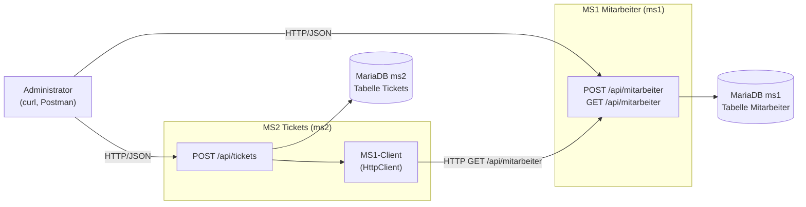
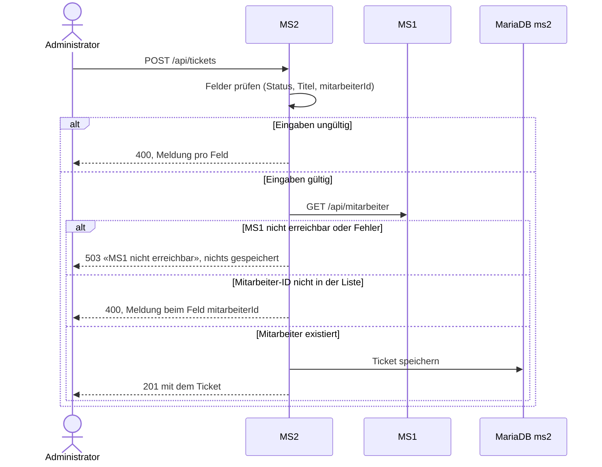
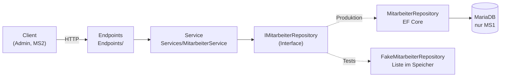

# Applikation und Technologie

Themenblock gemäss D1 ([team#19](https://github.com/m324-ap23a-team3/team/issues/19)). Beschreibt Aufbau, Technologie und Schnittstellen des Ticketsystems (Projekt 4). Grundlage ist die [Spezifikation](https://gitlab.com/ch-tbz-it/Stud/m324/-/blob/nuy/Projekt/Applikationen/Projekt4_Ticketsystem.md) mit den User Stories US1–US3.

**Inhalt**

1. [Überblick](#1-überblick)
2. [Architektur](#2-architektur)
3. [Technologie und Entscheide](#3-technologie-und-entscheide)
4. [Aufruf MS2 → MS1](#4-aufruf-ms2--ms1)
5. [Endpunkte mit Beispielen](#5-endpunkte-mit-beispielen)
6. [MS1: Testbare Architektur](#6-ms1-testbare-architektur)
7. [Datenbanken](#7-datenbanken)
8. [Offene Punkte](#8-offene-punkte)

---

## 1. Überblick

Das Ticketsystem besteht aus zwei unabhängigen Backend-Microservices ohne Frontend. Bedient werden sie von einem Administrator über HTTP (z. B. mit `curl`, Postman oder der OpenAPI-Beschreibung).

| Service | Repo | Zweck | User Stories |
|---|---|---|---|
| **MS1 Mitarbeiter** | [ms1](https://github.com/m324-ap23a-team3/ms1) | Mitarbeiter erfassen und auslesen | US1, US2 |
| **MS2 Tickets** | [ms2](https://github.com/m324-ap23a-team3/ms2) | Tickets erfassen und einem Mitarbeiter zuweisen | US3 |

Beide Services sind eigene Projekte mit eigenem Repo, eigener Pipeline, eigenem Docker-Image und eigener Datenbank. Die Spezifikation verlangt, dass US3 die Mitarbeiter **über den Endpunkt von US2** prüft und nicht aus der Datenbank von MS1 liest.

## 2. Architektur



- **Je eine Datenbank pro Service.** MS1 kennt nur `ms1`, MS2 nur `ms2`. Es gibt keinen Fremdschlüssel von `Tickets.MitarbeiterId` auf `Mitarbeiter.Id`, weil die Tabellen in verschiedenen Datenbanken liegen.
- **Einzige Verbindung zwischen den Services:** MS2 ruft beim Erfassen eines Tickets `GET /api/mitarbeiter` von MS1 über HTTP auf (Abschnitt 4).
- **MS1 kennt MS2 nicht.** MS1 läuft und funktioniert auch ohne MS2.

### Lokale Adressen (Entwicklung)

| | MS1 | MS2 |
|---|---|---|
| API (`dotnet run`, Profil `http`) | `http://localhost:5181` | `http://localhost:5217` |
| MariaDB (`docker compose up -d` im jeweiligen Repo) | `localhost:3306`, DB `ms1` | `localhost:3307`, DB `ms2` |
| Health-Check | `GET /health` | `GET /health` |
| OpenAPI | `GET /openapi/v1.json`, Kopie in [`docs/openapi.json`](https://github.com/m324-ap23a-team3/ms1/blob/main/docs/openapi.json) | `GET /openapi/v1.json` (nur Development, OpenAPI-Doku folgt mit [ms2#8](https://github.com/m324-ap23a-team3/ms2/issues/8)) |

Ein gemeinsames Setup, das MS1, MS2 und beide Datenbanken mit einem Befehl startet, folgt mit [ms2#7](https://github.com/m324-ap23a-team3/ms2/issues/7).

### Schichten innerhalb eines Service

Beide Services sind gleich aufgebaut:

```
Endpoints  →  Service  →  Repository-Interface  →  EF Core  →  MariaDB
                  └────→  MS1-Client-Interface   →  HTTP     →  MS1      (nur MS2)
```

| Schicht | Aufgabe |
|---|---|
| Endpoints (`Endpoints/`) | HTTP: Request lesen, Statuscode und Antwort setzen. Keine Logik. |
| Service (`Services/`) | Validierung, Umwandlung Request/Response ↔ Entity, Fehlerbehandlung. Kennt kein HTTP und kein EF Core. |
| Repository (`Data/`) | Datenzugriff mit EF Core, keine Logik. |
| MS1-Client (`Clients/`, nur MS2) | Fragt MS1 über HTTP, ob ein Mitarbeiter existiert. |

Der Service hängt nur von Interfaces ab. Dadurch laufen die Unit Tests ohne Datenbank und ohne MS1 (Details für MS1 in Abschnitt 6).

## 3. Technologie und Entscheide

Die Grundentscheide sind in [Ticket #1 (Kickoff-Entscheidungen)](https://github.com/m324-ap23a-team3/team/issues/1) festgehalten und begründet. Zusammenfassung:

| Thema | Entscheid (Ticket #1) |
|---|---|
| Sprache/Framework MS1 und MS2 | C# / ASP.NET Core Web API, .NET 10 (LTS). Gleiche Toolchain für beide Services, dadurch gleiche Pipeline und gleiches Dockerfile-Muster. |
| Tests | xUnit, API-Tests mit `WebApplicationFactory` ohne laufenden Server |
| Datenbank | MariaDB, je eine Instanz pro Service, in der Entwicklung als Docker-Container. Anbindung mit EF Core (Pomelo-Provider). |
| Aufruf MS2 → MS1 | über `HttpClient` |
| Frontend | keines |
| Plattform | GitHub (Repos, Actions, Container-Registry GHCR) |

Bei der Umsetzung sind folgende technische Festlegungen dazugekommen:

| Thema | Festlegung | Begründung / Quelle |
|---|---|---|
| EF Core-Version | EF Core 9 mit `Pomelo.EntityFrameworkCore.MySql` 9 auf .NET 10 | Pomelo gibt es noch nicht für EF Core 10 ([ms1#2](https://github.com/m324-ap23a-team3/ms1/issues/2)) |
| Schema | EF-Core-Migrationen im Repo (`Data/Migrations`), lokal beim Start angewendet | `Datenbank:MigrationBeimStart=true` nur in Development |
| Connection-String | nur aus der Konfiguration (`ConnectionStrings:Ms1Db` bzw. `Ms2Db`), nie im Code | lokal `appsettings.Development.json`, später als Secret/Umgebungsvariable |
| Fehlerformat | ProblemDetails (RFC 9457), bei Validierungsfehlern eine Meldung pro Feld in `errors` | US1 AK8, US2 AK6, US3 AK9 verlangen klare Fehlermeldungen |
| Zahlen in JSON | nur als JSON-Zahl (`"skilllevel": 4`), nicht als Text (`"4"`) | strikte Typen, passend zur OpenAPI-Beschreibung |
| Datum MS1 | Eingabe `TT.MM.JJJJ` (wie Spezifikation) oder `JJJJ-MM-TT`, Ausgabe immer `TT.MM.JJJJ`, in der DB als `date` | US1 AK3 |
| Datum MS2 | Review- und Done-Datum in UTC (ISO 8601 mit `Z`), in der DB als `datetime` | US3 AK4–5 |
| Ticket-Status | in der DB als Text (`Open`, `InProgress`, `Review`, `Done`) mit Check-Constraint; Eingabe auch als «In Progress» | lesbar in der DB, unabhängig von der Enum-Reihenfolge |

## 4. Aufruf MS2 → MS1

Beim Erfassen eines Tickets (US3) prüft MS2, ob der zugewiesene Mitarbeiter existiert. Dafür ruft MS2 den US2-Endpunkt von MS1 auf und sucht die `mitarbeiterId` in `mitarbeiter[].id`.



| Regel | Umsetzung |
|---|---|
| Kein Zugriff auf die DB von MS1 | MS2 hat keinen Connection-String zu `ms1`, nur den HTTP-Client |
| MS1 wird erst gefragt, wenn der Rest gültig ist | spart den Aufruf bei ohnehin ungültigen Eingaben |
| Unbekannter Mitarbeiter | `400`, Meldung «Es gibt keinen Mitarbeiter mit der ID 99.» |
| MS1 nicht erreichbar | `503`, Ticket wird **nicht** gespeichert (lieber kein Ticket als eines mit ungeprüftem Mitarbeiter) |
| Basis-URL von MS1 | über Konfiguration, nicht im Code ([ms2#3](https://github.com/m324-ap23a-team3/ms2/issues/3)) |
| Tests | Unit- und API-Tests ersetzen den Client durch einen Fake. Der echte Aufruf wird im Systemtest in der Pipeline geprüft ([ms2#9](https://github.com/m324-ap23a-team3/ms2/issues/9)). |

**Stand 23.11.2026:** Der Endpunkt `POST /api/tickets` ist im Review ([ms2 PR #11](https://github.com/m324-ap23a-team3/ms2/pull/11)). Der echte HTTP-Client folgt mit [ms2#3](https://github.com/m324-ap23a-team3/ms2/issues/3). Bis dahin antwortet MS2 ausserhalb der Tests mit `503`, damit kein Ticket ohne geprüften Mitarbeiter gespeichert wird.

**Hinweis:** Für die Prüfung lädt MS2 die ganze Mitarbeiterliste. Bei der erwarteten Grösse ist das unproblematisch. Ein Endpunkt `GET /api/mitarbeiter/{id}` in MS1 wäre die schlankere Lösung und kann bei Bedarf nachgezogen werden.

## 5. Endpunkte mit Beispielen

Alle Endpunkte sprechen JSON. Feldnamen sind in camelCase. Fehler kommen als `application/problem+json`.

| Service | Methode | Route | User Story | Antworten |
|---|---|---|---|---|
| MS1 | `POST` | `/api/mitarbeiter` | US1 Mitarbeiter erfassen | `201`, `400`, `503` |
| MS1 | `GET` | `/api/mitarbeiter` | US2 Alle Mitarbeiter auslesen | `200`, `503` |
| MS2 | `POST` | `/api/tickets` | US3 Ticket erfassen | `201`, `400`, `503` |
| beide | `GET` | `/health` | Betrieb | `200` |

### 5.1 MS1 `POST /api/mitarbeiter` (US1)

| Feld | Typ | Pflicht | Regel |
|---|---|---|---|
| `vorname` | Text | ja | höchstens 100 Zeichen, Leerzeichen am Rand werden entfernt |
| `nachname` | Text | ja | höchstens 100 Zeichen |
| `beitrittsdatum` | Text | ja | `TT.MM.JJJJ` oder `JJJJ-MM-TT`, muss ein gültiges Datum sein |
| `skilllevel` | Zahl | ja | ganze Zahl von 1 bis 5 |

Die `id` vergibt die Datenbank.

**Request**

```bash
curl -X POST http://localhost:5181/api/mitarbeiter \
  -H 'Content-Type: application/json' \
  -d '{"vorname":"Max","nachname":"Muster","beitrittsdatum":"15.05.2021","skilllevel":4}'
```

**`201 Created`**

```json
{
  "id": 1,
  "vorname": "Max",
  "nachname": "Muster",
  "beitrittsdatum": "15.05.2021",
  "skilllevel": 4
}
```

**`400 Bad Request`** (z. B. `{"vorname":"","beitrittsdatum":"31.02.2021","skilllevel":6}`)

```json
{
  "type": "https://tools.ietf.org/html/rfc9110#section-15.5.1",
  "title": "Die Eingaben sind ungültig.",
  "status": 400,
  "detail": "Bitte die markierten Felder korrigieren.",
  "errors": {
    "vorname": ["Vorname ist ein Pflichtfeld."],
    "nachname": ["Nachname ist ein Pflichtfeld."],
    "beitrittsdatum": ["Beitrittsdatum «31.02.2021» ist kein gültiges Datum. Erwartet wird TT.MM.JJJJ, z. B. «15.05.2021»."],
    "skilllevel": ["Skilllevel muss zwischen 1 und 5 liegen, war aber 6."]
  }
}
```

Ein falscher Datentyp (z. B. `"skilllevel": "vier"`) ergibt ebenfalls `400` mit der Meldung «Skilllevel muss eine ganze Zahl von 1 bis 5 sein.» beim Feld `skilllevel`.

**`503 Service Unavailable`** (Datenbank nicht erreichbar)

```json
{
  "type": "https://tools.ietf.org/html/rfc9110#section-15.6.4",
  "title": "Datenbank nicht verfügbar",
  "status": 503,
  "detail": "Der Mitarbeiter konnte wegen eines Datenbankfehlers nicht gespeichert werden. Bitte später erneut versuchen."
}
```

### 5.2 MS1 `GET /api/mitarbeiter` (US2)

Liefert alle Mitarbeiter, sortiert nach `id`. Eine leere Liste ist kein Fehler (US2 AK5). Diesen Endpunkt verwendet auch MS2.

**Request**

```bash
curl http://localhost:5181/api/mitarbeiter
```

**`200 OK`**

```json
{
  "anzahl": 2,
  "meldung": "2 Mitarbeiter gefunden.",
  "mitarbeiter": [
    { "id": 1, "vorname": "Max", "nachname": "Muster", "beitrittsdatum": "15.05.2021", "skilllevel": 4 },
    { "id": 2, "vorname": "Anna", "nachname": "Beispiel", "beitrittsdatum": "31.01.2020", "skilllevel": 2 }
  ]
}
```

**`200 OK`, keine Mitarbeiter erfasst**

```json
{
  "anzahl": 0,
  "meldung": "Es sind noch keine Mitarbeiter erfasst.",
  "mitarbeiter": []
}
```

**`503 Service Unavailable`**: wie bei 5.1, mit `detail` «Die Mitarbeiter konnten wegen eines Datenbankfehlers nicht geladen werden. Bitte später erneut versuchen.»

### 5.3 MS2 `POST /api/tickets` (US3)

Stand: im Review ([ms2 PR #11](https://github.com/m324-ap23a-team3/ms2/pull/11)). Review- und Done-Datum mit Validierung folgen mit [ms2#5](https://github.com/m324-ap23a-team3/ms2/issues/5).

| Feld | Typ | Pflicht | Regel |
|---|---|---|---|
| `status` | Text | ja | `Open`, `InProgress` (auch «In Progress»), `Review` oder `Done`, Gross-/Kleinschreibung egal |
| `titel` | Text | ja | höchstens 200 Zeichen |
| `beschreibung` | Text | nein | ohne Längenbegrenzung |
| `mitarbeiterId` | Zahl | ja | positive ganze Zahl, Mitarbeiter muss in MS1 existieren |
| `reviewDatum` | Datum/Zeit UTC | nein | folgt mit ms2#5: nur bei Status `Review` oder `Done` |
| `doneDatum` | Datum/Zeit UTC | nein | folgt mit ms2#5: nur bei Status `Done` |

**Request**

```bash
curl -X POST http://localhost:5217/api/tickets \
  -H 'Content-Type: application/json' \
  -d '{"status":"Open","titel":"Drucker defekt","beschreibung":"2. Stock","mitarbeiterId":1}'
```

**`201 Created`**

```json
{
  "id": 1,
  "status": "Open",
  "titel": "Drucker defekt",
  "beschreibung": "2. Stock",
  "reviewDatum": null,
  "doneDatum": null,
  "mitarbeiterId": 1
}
```

**`400 Bad Request`**, Mitarbeiter existiert in MS1 nicht (`"mitarbeiterId": 99`)

```json
{
  "type": "https://tools.ietf.org/html/rfc9110#section-15.5.1",
  "title": "Die Eingaben sind ungültig.",
  "status": 400,
  "detail": "Bitte die markierten Felder korrigieren.",
  "errors": {
    "mitarbeiterId": ["Es gibt keinen Mitarbeiter mit der ID 99."]
  }
}
```

**`400 Bad Request`**, Pflichtfelder fehlen (`{}`)

```json
{
  "type": "https://tools.ietf.org/html/rfc9110#section-15.5.1",
  "title": "Die Eingaben sind ungültig.",
  "status": 400,
  "detail": "Bitte die markierten Felder korrigieren.",
  "errors": {
    "status": ["Status ist ein Pflichtfeld. Erlaubt sind: Open, InProgress, Review, Done."],
    "titel": ["Titel ist ein Pflichtfeld."],
    "mitarbeiterId": ["Ein Ticket braucht einen Mitarbeiter: mitarbeiterId ist ein Pflichtfeld."]
  }
}
```

**`503 Service Unavailable`**, MS1 nicht erreichbar

```json
{
  "type": "https://tools.ietf.org/html/rfc9110#section-15.6.4",
  "title": "Dienst nicht verfügbar",
  "status": 503,
  "detail": "Der Mitarbeiter konnte nicht geprüft werden, weil MS1 nicht erreichbar ist. Das Ticket wurde nicht gespeichert. Bitte später erneut versuchen."
}
```

Ist die Datenbank von MS2 nicht erreichbar, kommt ebenfalls `503` mit `detail` «Das Ticket konnte wegen eines Datenbankfehlers nicht gespeichert werden. Bitte später erneut versuchen.»

### 5.4 `GET /health` (beide)

```bash
curl http://localhost:5181/health
```

```json
{ "status": "ok", "service": "ms1" }
```

MS2 antwortet gleich mit `"service": "ms2"`. Der Health-Check prüft nur, ob der Service läuft, nicht die Datenbank.

## 6. MS1: Testbare Architektur

**Ziel:** Die Unit Tests prüfen Validierung und Logik der Endpunkte, ohne dass eine Datenbank läuft. So laufen sie bei allen lokal und in der Pipeline (Vorgabe P2: «Tests müssen isoliert sein»). MS2 ist nach demselben Muster aufgebaut und ersetzt zusätzlich den MS1-Client durch einen Fake.

### Schichten



| Schicht | Ordner in `ms1` | Aufgabe | Kennt |
|---|---|---|---|
| Endpoints | `src/Ms1.Api/Endpoints` | HTTP: Request lesen, Statuscode und Antwort setzen | Service |
| Service | `src/Ms1.Api/Services` | Geschäftslogik: Validierung (z. B. Skilllevel 1–5), Umwandeln zwischen Request/Response und Entity, Fehlerbehandlung | `IMitarbeiterRepository` |
| Repository-Interface | `src/Ms1.Api/Data/IMitarbeiterRepository.cs` | Vertrag für den Datenzugriff | Entity |
| Repository | `src/Ms1.Api/Data/MitarbeiterRepository.cs` | Datenzugriff mit EF Core, keine Logik | `Ms1DbContext` |
| Entity | `src/Ms1.Api/Models` | Datenmodell `Mitarbeiter` | – |

Die Abhängigkeiten zeigen nur nach rechts. Der Service hängt vom **Interface** ab, nicht von EF Core. Welche Implementierung verwendet wird, entscheidet die Dependency Injection in `Program.cs` bzw. `AddMs1Datenbank`.

### Tests ohne Datenbank

| Testart | Was wird getestet | Datenbank |
|---|---|---|
| Unit Test Service | `MitarbeiterService` direkt mit `FakeMitarbeiterRepository` | keine |
| API-Test | ganzer HTTP-Weg mit `Ms1ApiFactory` (`WebApplicationFactory`), Repository durch Fake ersetzt | keine |
| Repository-Test | `MitarbeiterRepository` mit dem EF-Core-InMemory-Provider (kein Change-Tracking, Sortierung) | keine |
| Integrationstest (P3, [team#24](https://github.com/m324-ap23a-team3/team/issues/24)) | `MitarbeiterRepository` gegen echte MariaDB in der Pipeline | MariaDB |

- `FakeMitarbeiterRepository` hält die Daten in einer Liste und vergibt IDs selbst. Mit der Eigenschaft `Fehler` lässt sich ein Datenbankausfall simulieren (Sad Path, z. B. «Fehler beim Laden»).
- `Ms1ApiFactory` ersetzt das Repository durch den Fake und schaltet Migrationen beim Start aus.
- Jeder Test ist mit einem XML-Doc-Kommentar (`/// <summary>`) beschrieben (Vorgabe P2: JavaDoc oder Äquivalent).

## 7. Datenbanken

| | MS1 | MS2 |
|---|---|---|
| Datenbank | MariaDB 11.4, DB `ms1` | MariaDB 11.4, DB `ms2` |
| Tabelle | `Mitarbeiter` | `Tickets` |
| Spalten | `Id` (auto), `Vorname` und `Nachname` (`varchar(100)`), `Beitrittsdatum` (`date`), `Skilllevel` (`int`) | `Id` (auto), `Status` (`varchar(20)`), `Titel` (`varchar(200)`), `Beschreibung` (Text, optional), `ReviewDatum` und `DoneDatum` (`datetime`, UTC, optional), `MitarbeiterId` (`int`) |
| Check-Constraint | `Skilllevel BETWEEN 1 AND 5` | `Status IN ('Open', 'InProgress', 'Review', 'Done')` |
| Connection-String | `ConnectionStrings:Ms1Db` | `ConnectionStrings:Ms2Db` |
| Lokal | `docker-compose.yml` in `ms1`, Port 3306 | `docker-compose.yml` in `ms2`, Port 3307 |

Die Check-Constraints sind eine zweite Absicherung. Die eigentliche Validierung mit verständlicher Meldung macht der Service. `Tickets.MitarbeiterId` ist bewusst kein Fremdschlüssel (Abschnitt 2). Details: [ms1 README](https://github.com/m324-ap23a-team3/ms1#datenbank), [ms2 README](https://github.com/m324-ap23a-team3/ms2#datenbank).

## 8. Offene Punkte

| Punkt | Ticket |
|---|---|
| Reicht für die «Systemübersicht» (US1 AK7, US3 AK8) der Rückgabewert des POST, oder braucht es einen GET-Endpunkt für Tickets? Klärung mit der Lehrperson. | [team#20](https://github.com/m324-ap23a-team3/team/issues/20) |
| Echter HTTP-Client MS2 → MS1 | [ms2#3](https://github.com/m324-ap23a-team3/ms2/issues/3) |
| Review- und Done-Datum mit Validierung (US3 AK4, 5, 7) | [ms2#5](https://github.com/m324-ap23a-team3/ms2/issues/5) |
| Gemeinsames lokales Setup MS1 + MS2 | [ms2#7](https://github.com/m324-ap23a-team3/ms2/issues/7) |
| Systemtest MS2 → MS1 in der Pipeline | [ms2#9](https://github.com/m324-ap23a-team3/ms2/issues/9) |
| Integrationstests mit echter DB | [team#24](https://github.com/m324-ap23a-team3/team/issues/24) |
| Migrationen und Connection-Strings in Staging/Produktion | P4 ([team#32](https://github.com/m324-ap23a-team3/team/issues/32)) |

---

## Änderungsverlauf

| Datum | Änderung |
|---|---|
| 23.11.2026 | Erste Version: testbare Architektur MS1 (ms1#3) |
| 23.11.2026 | Vollständiger Themenblock: Architektur MS1/MS2, Technologie und Entscheide (Ticket #1), Aufruf MS2 → MS1, Endpunkte mit Beispielen, Datenbanken, offene Punkte (team#19) |
