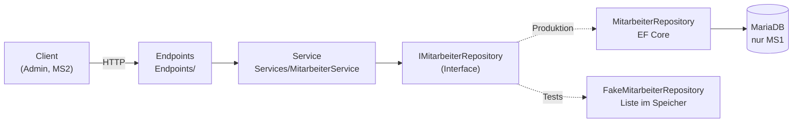

# Applikation und Technologie

Themenblock gemäss D1. Beschreibt, wie die beiden Microservices aufgebaut sind. Der vollständige Themenblock (Gesamtarchitektur, Endpunkte mit Beispielen, Entscheide) folgt mit [team#19](https://github.com/m324-ap23a-team3/team/issues/19). Hier steht vorerst die testbare Architektur von MS1 ([ms1#3](https://github.com/m324-ap23a-team3/ms1/issues/3)).

## MS1: Testbare Architektur

**Ziel:** Die Unit Tests prüfen Validierung und Logik der Endpunkte, ohne dass eine Datenbank läuft. So laufen sie bei allen lokal und in der Pipeline (Vorgabe P2: «Tests müssen isoliert sein»).

### Schichten

| Schicht | Ordner in `ms1` | Aufgabe | Kennt |
|---|---|---|---|
| Endpoints | `src/Ms1.Api/Endpoints` | HTTP: Request lesen, Statuscode und Antwort setzen | Service |
| Service | `src/Ms1.Api/Services` | Geschäftslogik: Validierung (z. B. Skilllevel 1–5), Umwandeln zwischen Request/Response und Entity, Fehlerbehandlung | `IMitarbeiterRepository` |
| Repository-Interface | `src/Ms1.Api/Data/IMitarbeiterRepository.cs` | Vertrag für den Datenzugriff | Entity |
| Repository | `src/Ms1.Api/Data/MitarbeiterRepository.cs` | Datenzugriff mit EF Core, keine Logik | `Ms1DbContext` |
| Entity | `src/Ms1.Api/Models` | Datenmodell `Mitarbeiter` | – |

Die Abhängigkeiten zeigen nur nach rechts. Der Service hängt vom **Interface** ab, nicht von EF Core. Welche Implementierung verwendet wird, entscheidet die Dependency Injection in `Program.cs` bzw. `AddMs1Datenbank`.

### Tests ohne Datenbank

| Testart | Was wird getestet | Datenbank |
|---|---|---|
| Unit Test Service | `MitarbeiterService` direkt mit `FakeMitarbeiterRepository` | keine |
| API-Test | ganzer HTTP-Weg mit `Ms1ApiFactory` (`WebApplicationFactory`), Repository durch Fake ersetzt | keine |
| Integrationstest (P3, [team#24](https://github.com/m324-ap23a-team3/team/issues/24)) | `MitarbeiterRepository` gegen echte MariaDB in der Pipeline | MariaDB |

- `FakeMitarbeiterRepository` hält die Daten in einer Liste und vergibt IDs selbst. Mit der Eigenschaft `Fehler` lässt sich ein Datenbankausfall simulieren (Sad Path, z. B. «Fehler beim Laden»).
- `Ms1ApiFactory` ersetzt das Repository durch den Fake und schaltet Migrationen beim Start aus.
- Jeder Test ist mit einem XML-Doc-Kommentar (`/// 
`) beschrieben (Vorgabe P2: JavaDoc oder Äquivalent).

### Datenbank

Eigene MariaDB-Instanz nur für MS1 (`docker-compose.yml` in `ms1`). MS2 greift nie auf diese Datenbank zu, sondern liest Mitarbeiter über den Endpunkt aus US2 (`GET /api/mitarbeiter`). Der Connection-String kommt nur aus der Konfiguration (`ConnectionStrings:Ms1Db`). Details: [ms1 README](https://github.com/m324-ap23a-team3/ms1#datenbank).

---

## Änderungsverlauf

| Datum | Änderung |
|---|---|
| 23.11.2026 | Erste Version: testbare Architektur MS1 (ms1#3) |
