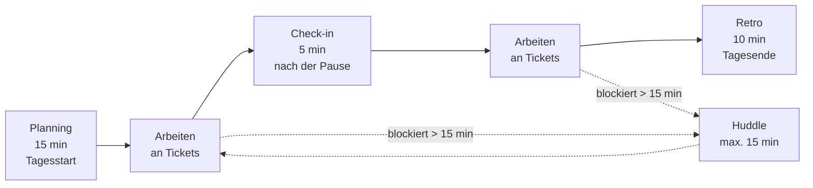
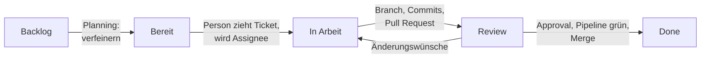
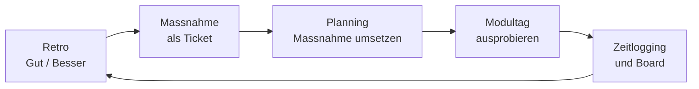

# Meetings und Arbeitsprozesse

Themenblock gemäss D1/D3. Dieses Dokument beschreibt, **wie wir als Team zusammenarbeiten**: welche Meetings es gibt, wer welche Rolle hat, wie ein Ticket über das Board läuft und wie wir unseren Prozess laufend verbessern.

> **Neu im Team?** Lies zuerst [Kurzüberblick](#1-kurzüberblick) und [Onboarding](#9-onboarding-für-neue-teammitglieder). Der Rest ist Nachschlagewerk.

**Inhalt**

1. [Kurzüberblick](#1-kurzüberblick)
2. [Rollen](#2-rollen)
3. [Meetings](#3-meetings)
4. [Meeting-Regeln](#4-meeting-regeln)
5. [Kanban-Board](#5-kanban-board)
6. [Arbeitsprozess eines Tickets](#6-arbeitsprozess-eines-tickets)
7. [Abwechslung und Rotation](#7-abwechslung-und-rotation)
8. [Kontinuierliche Verbesserung](#8-kontinuierliche-verbesserung)
9. [Onboarding für neue Teammitglieder](#9-onboarding-für-neue-teammitglieder)
10. [Änderungsverlauf](#10-änderungsverlauf)

---

## 1. Kurzüberblick

Ein Modultag hat rund 180 Minuten. Davon sind höchstens **30 Minuten Meetings** (≈ 17 %), der Rest ist Arbeit an Tickets.

| Was | Wann | Dauer | Ergebnis |
|---|---|---|---|
| [Planning](#31-planning) | Start jedes Modultags | 15 min | Jede Person hat ein Ticket, genug Tickets in «Bereit» |
| [Check-in](#32-check-in) | Nach der Pause | 5 min | Blocker sind bekannt und haben eine Lösung |
| [Retro](#33-retro) | Letzte 10 min des Modultags | 10 min | Was lief gut, was verbessern wir, eine Massnahme als Ticket |
| [Huddle](#34-huddle-ad-hoc) | Bei Bedarf | max. 15 min | Technisches Problem gelöst oder Entscheid getroffen |
| [Review / Demo](#35-review--demo) | Vor jeder Abnahme (P2, P3, P4) | 20 min | Jede Person kann das ganze System erklären |
| [Code Review](#36-code-review-asynchron) | Laufend, im Pull Request | – | Kein Merge ohne Review |

Alle Meetings werden im Zeitlogging auf das Ticket **`Meetings`** mit der Art `Meeting` geloggt, pro Person.

---

## 2. Rollen

### 2.1 Team und Verantwortung (fachlich)

Wir sind ein gemeinsames DevOps-Team: **Alle entwickeln, testen, bauen Pipelines und deployen.** Es gibt keine festen Dev- oder Ops-Rollen, und alle haben in `ms1` und `ms2` dieselben Rechte.

| Mitglied | GitHub |
|---|---|
| Nico | @NicoM77 |
| Ardit | @ardit-kashtanjeva |
| Gabriel | @gabrielgreco11 |
| Eduard | @Eduard452 |

Verantwortung entsteht **pro Ticket**: Wer ein Ticket zieht, ist dafür verantwortlich, bis es «Done» ist. Damit niemand nur einen Bereich kennt, rotieren die Themen (siehe [Abwechslung](#7-abwechslung-und-rotation)). Alle müssen das ganze System erklären können.

Die **Lehrperson** ist unsere Auftraggeberin (Product Owner). Sie bringt Anforderungen, priorisiert bei Unklarheiten und nimmt die Ergebnisse ab. Fragen an die Lehrperson sammelt die Moderation und stellt sie gebündelt.

### 2.2 Meeting-Rollen (rotierend)

Jeden Modultag hat jede Person genau **eine** der vier Rollen. Die Rollen rotieren täglich, damit alle jede Rolle mehrmals übernehmen.

| Rolle | Aufgaben |
|---|---|
| **Moderation** | Leitet Planning, Check-in und Retro. Achtet darauf, dass alle zu Wort kommen. Ansprechperson für die Lehrperson an diesem Tag. |
| **Protokoll** | Legt vor dem Planning das Tagesprotokoll aus der [Vorlage](./meetings/_vorlage.md) an, hält Entscheide, Blocker und Retro-Ergebnisse fest, committet das Protokoll am Tagesende. |
| **Timekeeper** | Startet Meetings pünktlich, meldet «noch 2 Minuten», beendet Themen bei Timebox-Ende und schiebt sie auf den Parkplatz. Erinnert vor jeder Pause ans Zeitlogging. |
| **Board** | Hält das Kanban-Board während des Tages sauber (richtige Spalte, Assignee, keine vergessenen Karten), prüft WIP-Limits und den Vorrat in «Bereit». |

**Rotationsplan** (Modultag 5 beginnt wieder wie Modultag 1):

| Modultag | Moderation | Protokoll | Timekeeper | Board |
|---|---|---|---|---|
| 1, 5, 9, … | Nico | Ardit | Gabriel | Eduard |
| 2, 6, 10, … | Eduard | Nico | Ardit | Gabriel |
| 3, 7, 11, … | Gabriel | Eduard | Nico | Ardit |
| 4, 8, 12, … | Ardit | Gabriel | Eduard | Nico |

Fehlt jemand, übernimmt die Moderation zusätzlich dessen Rolle. Die effektive Besetzung steht im Tagesprotokoll.

---

## 3. Meetings

Jedes Meeting hat eine feste Agenda mit Zeitbudget. Die Agenda steht im Tagesprotokoll, bevor das Meeting beginnt.

### 3.1 Planning

| | |
|---|---|
| **Wann** | Pünktlich zu Beginn jedes Modultags |
| **Dauer** | 15 min |
| **Wer** | Ganzes Team, geleitet von der Moderation |
| **Ziel** | Alle wissen, woran sie heute arbeiten, und es gibt genug vorbereitete Tickets |
| **Vorbereitung** | Protokoll ist angelegt, Board ist offen (auf einem geteilten Bildschirm) |

| Zeit | Agendapunkt | Inhalt |
|---|---|---|
| 2 min | Rückblick | Massnahme aus der letzten Retro vorlesen: Setzen wir sie heute um? |
| 3 min | Board-Check | Die Board-Rolle geht die Spalten **von rechts nach links** durch (Review → In Arbeit → Bereit). Was ist fertig, was hängt? |
| 5 min | Tagesziel und Verteilung | Tagesziel in einem Satz festlegen. Reihum zieht jede Person ein Ticket aus «Bereit» (Pull-Prinzip). Zuerst Begonnenes abschliessen: *stop starting, start finishing*. |
| 4 min | Backlog auffüllen | Liegen in «Bereit» weniger als **2 Tickets pro Person**, werden Tickets aus dem Backlog verfeinert (Akzeptanzkriterien, Schätzung) und nachgezogen. |
| 1 min | Abschluss | Offene Fragen an die Lehrperson festhalten, Moderation stellt sie. |

**Ergebnis:** Jede Person hat ein Ticket in «In Arbeit», mindestens 8 Tickets liegen in «Bereit», Tagesziel steht im Protokoll.

### 3.2 Check-in

| | |
|---|---|
| **Wann** | Direkt nach der Pause |
| **Dauer** | 5 min, stehend |
| **Wer** | Ganzes Team |
| **Ziel** | Blocker früh erkennen |

Reihum beantwortet jede Person in höchstens **1 Minute**:

1. Woran arbeite ich, bin ich auf Kurs fürs Tagesziel?
2. Bin ich blockiert oder warte ich (auf Review, Pipeline, Lehrperson)?

Blocker werden **nicht** im Check-in gelöst, sondern direkt danach in einem [Huddle](#34-huddle-ad-hoc) mit den betroffenen Personen. Die Board-Rolle markiert blockierte Tickets mit dem Label `blockiert`.

### 3.3 Retro

| | |
|---|---|
| **Wann** | Die letzten 10 min jedes Modultags |
| **Dauer** | 10 min |
| **Wer** | Ganzes Team |
| **Ziel** | Jeden Tag etwas an unserem Prozess verbessern |

| Zeit | Agendapunkt | Inhalt |
|---|---|---|
| 2 min | Stilles Schreiben | Jede Person schreibt für sich 1–2 Punkte zu **Gut** und **Besser** auf (direkt ins Protokoll). So kommt jede Stimme vor, nicht nur die lauteste. |
| 1 min | Zahlen | Kurzer Blick ins Zeitlogging: Wie viel `Warten` hatten wir, und worauf? Wo lag die Schätzung daneben? |
| 4 min | Besprechen | Reihum stellt jede Person ihre Punkte kurz vor. Ähnliche Punkte werden zusammengefasst. |
| 2 min | Massnahme | Das Team wählt **eine** konkrete Massnahme für den nächsten Modultag. Sie wird als Ticket mit Label `verbesserung` erfasst. |
| 1 min | Abschluss | Board-Rolle prüft: Alle Karten in der richtigen Spalte? Alle haben ihre Zeit geloggt? |

**Ergebnis:** Gut/Besser/Massnahme im Protokoll, Massnahme als Ticket auf dem Board.

### 3.4 Huddle (ad hoc)

| | |
|---|---|
| **Wann** | Sobald jemand **länger als 15 Minuten** an etwas festhängt, oder für einen technischen Entscheid |
| **Dauer** | max. 15 min |
| **Wer** | Nur die betroffenen Personen |
| **Ziel** | Problem lösen oder Entscheid treffen, ohne das ganze Team zu stoppen |

- Wer festhängt, ruft den Huddle aus (im Team-Chat oder direkt).
- Ergebnis wird als Kommentar im betroffenen Ticket festgehalten.
- Grössere Entscheide (Technologie, Architektur, Prozess) kommen zusätzlich ins Tagesprotokoll unter «Entscheide» und werden im nächsten Planning dem ganzen Team kurz vorgestellt.

### 3.5 Review / Demo

| | |
|---|---|
| **Wann** | Bevor ein Praxisauftrag (P2, P3, P4) der Lehrperson zur Abnahme gezeigt wird |
| **Dauer** | 20 min |
| **Wer** | Ganzes Team |
| **Ziel** | Jede Person kann das ganze System erklären, nicht nur ihren Teil |

1. **Erklär-Runde (12 min):** Jede Person erklärt in 3 Minuten einen Teil, den sie **nicht selbst** gebaut hat (z. B. die Pipeline von `ms2` oder einen Endpunkt mit seinen Tests). Die Lehrperson fragt bei der Abnahme jede Person.
2. **Checkliste (5 min):** Bewertungskriterien des Auftrags durchgehen. Fehlendes wird als Ticket erfasst.
3. **Offene Punkte (3 min):** Was ist nicht erklärbar? → Ticket mit Label `docs` oder Wissensaustausch im nächsten Planning.

### 3.6 Code Review (asynchron)

Code Review ist kein Meeting, sondern läuft im Pull Request. Details zu Branches und Merge-Wegen stehen in der Branching-Strategie (D2).

- Jede Änderung an `ms1` und `ms2` geht über einen Pull Request mit mindestens **1 Approval** (technisch durch Branch-Schutz erzwungen, `main` ist geschützt).
- Reviewer ist nie die Person, die den PR erstellt hat, sondern nach Möglichkeit jemand, der **an diesem Teil noch nicht gearbeitet** hat. So kennen mehr Leute den Code.
- Ein offener Review-Request wird während des Modultags **innerhalb von 30 Minuten** angeschaut. Wer reviewt, zieht das vor einem neuen Ticket (*stop starting, start finishing*).
- Kommentare sind konkret und freundlich. Änderungswünsche werden im PR beantwortet, nicht mündlich.

---

## 4. Meeting-Regeln

| Regel | Warum |
|---|---|
| **Pünktlich starten.** Der Timekeeper startet zur abgemachten Zeit, auch wenn jemand fehlt. | Wartezeit von vier Personen ist teuer. |
| **Agenda steht vorher im Protokoll.** Kein Meeting ohne Agenda. | Alle wissen, worum es geht und wann es fertig ist. |
| **Timebox einhalten.** Ist die Zeit eines Punkts um, wird er auf den **Parkplatz** gesetzt (Abschnitt im Protokoll) und später im Huddle geklärt. | Meetings dauern nicht länger als nötig. |
| **Reihum sprechen.** In Planning, Check-in und Retro kommt jede Person in fester Reihenfolge dran, beginnend bei der Person nach der Moderation. | Alle beteiligen sich, niemand dominiert. |
| **Jede Person hat jedes Meeting mindestens einen Beitrag.** Die Moderation fragt aktiv nach, wer noch nichts gesagt hat. | Aktive Mitarbeit ist sichtbar. |
| **Entscheide mit Daumen** (hoch / quer / runter). Bei «runter» erklärt die Person kurz warum, dann wird nochmals abgestimmt; danach gilt die Mehrheit. | Schnelle Entscheide, Einwände werden gehört. |
| **Board ist die Wahrheit.** Was nicht auf dem Board steht, wird nicht gemacht. Neue Aufgaben aus Meetings werden sofort als Ticket erfasst. | Aufgaben gehen nicht verloren. |

---

## 5. Kanban-Board

Wir verwenden ein **GitHub Project** auf Organisationsebene, das die Issues aus allen Repos (`team`, `ms1`, `ms2` und ab P4 allenfalls ein Repo für die Deployment-Konfiguration) auf einem Board zeigt. Link: siehe [README](../README.md).

### 5.1 Spalten

| Spalte | Bedeutung | Eintritt, wenn … | WIP-Limit |
|---|---|---|---|
| **Backlog** | Alle bekannten Aufgaben, noch nicht verfeinert | Aufgabe ist erkannt | – |
| **Bereit** | Verfeinert und sofort startbar | [Definition of Ready](#53-definition-of-ready) erfüllt | mind. 8 (2 pro Person) |
| **In Arbeit** | Jemand arbeitet aktiv daran | Person ist als Assignee eingetragen | **4** (1 pro Person) |
| **Review** | Pull Request offen, wartet auf Review oder Anpassungen | PR ist erstellt und mit dem Ticket verknüpft | **3** |
| **Done** | Fertig | [Definition of Done](#54-definition-of-done) erfüllt | – |

- «Bereit» hat ein **Minimum** statt eines Maximums: So hat nie jemand Leerlauf.
- Ist das WIP-Limit in «Review» erreicht, wird zuerst reviewt, bevor jemand ein neues Ticket zieht.
- Blockierte Tickets bleiben in ihrer Spalte und bekommen das Label `blockiert` plus einen Kommentar, worauf gewartet wird.
- Ab P4 (Continuous Deployment) prüfen wir, ob eine Spalte **Deploy** zwischen Review und Done nötig ist. Änderungen an den Spalten stehen im [Änderungsverlauf](#10-änderungsverlauf).

### 5.2 Aufbau eines Tickets

| Feld | Inhalt |
|---|---|
| **Titel** | Kurz und als Tätigkeit: «US1 Mitarbeiter erfassen (POST /mitarbeiter)» |
| **Beschreibung** | Bei User Stories: «Als … möchte ich …, damit …» und **Akzeptanzkriterien** als Checkliste |
| **Repo** | Das Ticket liegt im Repo, in dem die Änderung passiert. Teamweite Themen (Doku, Meetings, Theorie) in `team`. |
| **Schätzung** | Projektfeld «Schätzung (min)». Wird in der Retro mit dem Zeitlogging verglichen. |
| **Assignee** | Wer daran arbeitet. Pro Ticket genau eine verantwortliche Person, Pairing wird im Kommentar erwähnt. |
| **Labels** | Bereich: `ms1`, `ms2`, `pipeline`, `deployment`, `docs`, `theorie`. Art: `bug`, `incident`, `verbesserung`. Status: `blockiert`. |

Grösser als **90 Minuten** geschätzte Tickets werden aufgeteilt, möglichst **vertikal** (eine durchgehende Funktion statt einer technischen Schicht).

**Daueraufträge** als Tickets im Repo `team` (für das Zeitlogging): `Meetings`, `Einrichten`, `Theorie`. Sie bleiben während des ganzen Moduls offen.

### 5.3 Definition of Ready

Ein Ticket darf von «Backlog» nach «Bereit», wenn:

- [ ] der Titel klar sagt, was zu tun ist,
- [ ] Akzeptanzkriterien vorhanden sind (wie prüfen wir, dass es fertig ist?),
- [ ] eine Schätzung eingetragen ist (max. 90 min),
- [ ] Bereichs-Label und Repo stimmen,
- [ ] keine offene Abhängigkeit das Starten verhindert.

### 5.4 Definition of Done

Ein Ticket darf nach «Done», wenn:

- [ ] alle Akzeptanzkriterien erfüllt sind,
- [ ] Code und Tests über einen reviewten Pull Request in `main` gemergt sind (bei Code-Tickets),
- [ ] die Pipeline grün ist,
- [ ] betroffene Dokumentation (README, `docs/`) aktualisiert ist,
- [ ] die Zeit im Zeitlogging auf das Ticket geloggt ist,
- [ ] das Issue geschlossen ist (automatisch über `Closes …` im PR).

---

## 6. Arbeitsprozess eines Tickets

1. **Ziehen:** Im Planning (oder sobald ein Ticket fertig ist) nimmt die Person das oberste passende Ticket aus «Bereit», trägt sich als Assignee ein und schiebt es nach «In Arbeit».
2. **Arbeiten:** Branch gemäss Branching-Strategie (D2) anlegen. Commits referenzieren das Ticket:
   `m324-ap23a-team3/<repo>#<nr> Kurzbeschreibung`
   Beispiel: `m324-ap23a-team3/ms1#4 POST /mitarbeiter mit Validierung`
3. **Festhängen:** Nach 15 Minuten ohne Fortschritt Hilfe holen (Huddle). Wartezeit im Zeitlogging als `Warten` mit Grund erfassen.
4. **Review:** Pull Request erstellen, im PR-Text `Closes m324-ap23a-team3/<repo>#<nr>`, Reviewer anfragen (siehe [Code Review](#36-code-review-asynchron)), Ticket nach «Review» schieben.
5. **Fertig:** Nach Approval und grüner Pipeline mergen. Das Issue schliesst sich automatisch, das Ticket landet in «Done». Definition of Done kurz prüfen.
6. **Nächstes:** Zuerst offene Reviews anschauen, dann das nächste Ticket aus «Bereit» ziehen.

**Kommunikation:**

| Kanal | Wofür |
|---|---|
| GitHub-Issue / Pull Request | Alles, was ein Ticket betrifft: Fragen, Entscheide, Review. Bleibt nachvollziehbar. |
| Tagesprotokoll in `docs/meetings/` | Meeting-Ergebnisse, Entscheide, Retro |
| Team-Chat | Kurze Absprachen, Huddle ausrufen. Ergebnisse gehören danach ins Ticket. |
| Lehrperson | Gebündelt über die Moderation des Tages |

---

## 7. Abwechslung und Rotation

Damit alle jeden Bereich kennenlernen und bei der Abnahme alles erklären können:

- **Meeting-Rollen** rotieren täglich ([Rotationsplan](#22-meeting-rollen-rotierend)).
- **User Stories** werden von unterschiedlichen Personen umgesetzt (P2: US1, US2 und US3 je von einer anderen Person).
- **Jede Person** übernimmt über das Modul mindestens je ein Ticket aus den Bereichen **Code**, **Tests**, **Pipeline (CI)**, **Deployment (CD)** und **Dokumentation**. Die Board-Rolle achtet im Planning darauf, dass niemand nur einen Bereich zieht.
- **Service-Wechsel:** Wer in P2 an `ms1` gearbeitet hat, baut in P3 die Pipeline von `ms2` mit, und umgekehrt.
- **Reviews** macht nach Möglichkeit jemand, der den Teil noch nicht kennt.
- **Pairing** bei neuen Themen: Wer etwas zum ersten Mal macht, arbeitet mit jemandem zusammen, der es schon kann. Das Ticket gehört der Person, die es zum ersten Mal macht.

---

## 8. Kontinuierliche Verbesserung

Unser Verbesserungszyklus folgt dem Third Way (Lernen und Experimentieren):

- **Jeden Modultag** eine Retro mit genau einer Massnahme (siehe [Retro](#33-retro)).
- Die Massnahme wird im nächsten Planning zuerst angeschaut: Wurde sie umgesetzt? Hat sie geholfen? Wenn ja und sie verändert unseren Prozess dauerhaft, wird **dieses Dokument** angepasst und im [Änderungsverlauf](#10-änderungsverlauf) eingetragen.
- **Datenquellen:** Zeitlogging (Anteil `Warten`, `Meeting`, `Incident`; Schätzung gegenüber Ist), Board (Tickets, die lange in einer Spalte liegen), Pipelines (fehlgeschlagene Läufe).
- **Meeting-Kosten im Blick:** Liegt der Anteil `Meeting` im Zeitlogging deutlich über 17 %, kürzen wir Agenda oder Meetings.

---

## 9. Onboarding für neue Teammitglieder

1. Dieses Dokument lesen, mindestens Kapitel 1, 2 und 6.
2. Zugriff prüfen: GitHub-Organisation, Board, Zeitlogging, Team-Chat (Links im [README](../README.md)).
3. Die letzten drei Tagesprotokolle in [`meetings/`](./meetings/) lesen: Was läuft gerade, welche Massnahmen gelten?
4. Sich in den [Rotationsplan](#22-meeting-rollen-rotierend) eintragen (Plan wird um eine Zeile und eine Spalte erweitert).
5. Erstes Ticket im Pairing mit einem bestehenden Teammitglied ziehen.
6. Ab dem ersten Tag die Zeit loggen.

---

## 10. Änderungsverlauf

| Datum | Änderung | Grund |
|---|---|---|
| 16.11.2026 | Erste Version: Meetings, Rollen, Board, Ticket-Prozess, Verbesserungszyklus | Auftrag D3, vor Beginn der Praxis |
