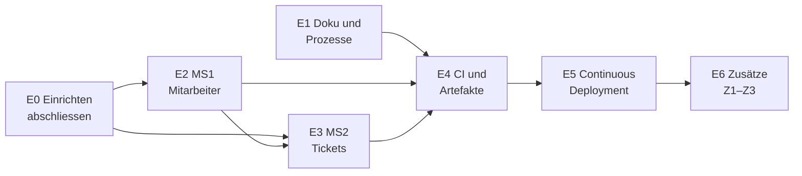

# Projektplan: Epics und Issues

Aufteilung von Projekt 4 «Ticketsystem» in Epics und Issues, abgeleitet aus der [Spezifikation](https://gitlab.com/ch-tbz-it/Stud/m324/-/blob/nuy/Projekt/Applikationen/Projekt4_Ticketsystem.md) und den Aufträgen P1–P4, D1–D3 und Z1–Z3. Wie Tickets über das Board laufen, steht in [Meetings und Arbeitsprozesse](./Meetings_Arbeitsprozesse.md).

## Aufbau auf GitHub

- **Epic** = Issue im Repo `team` mit Issue-Typ «Epic» und Label `epic`. Die einzelnen Issues hängen als **Sub-Issues** daran, auch wenn sie in `ms1`, `ms2` oder `infra` liegen. So zeigt jedes Epic seinen Fortschritt.
- **Issue** = Issue im Repo, in dem die Änderung passiert. Betrifft es mehrere Repos (z. B. ms1 und ms2), liegt es in `team` mit den passenden Labels. Typ «Task», «Feature» (User Story) oder «Bug».
- **Board-Felder:** `Status` (Spalten gemäss D3), `Schätzung (min)`, `Phase` (P1, P2, P3, P4, Z).
- Schätzungen sind Startwerte für das Planning. Kein Issue über 90 min (Definition of Ready); grössere werden beim Verfeinern geteilt.
- Wer ein Issue übernimmt, entscheidet das Planning (Pull-Prinzip). Fix vorgegeben ist nur die Rotation aus D3: US1, US2 und US3 setzen drei verschiedene Personen um, und P3 hat je eine verantwortliche Person für Teil A und Teil B.

## Übersicht

| Epic | GitHub | Inhalt | Repo(s) | Auftrag | Issues | Schätzung |
|---|---|---|---|---|---|---|
| [E0](#e0-einrichten-abschliessen) | [team#5](https://github.com/m324-ap23a-team3/team/issues/5) | Board, Zeitlogging, Labels, offene Punkte aus P1 | team, alle | P1 | 6 | ~2.5 h |
| [E1](#e1-dokumentation-und-prozesse) | [team#6](https://github.com/m324-ap23a-team3/team/issues/6) | Branching-Strategie, Versionierung, Doku-Themenblöcke | team | D1–D3 | 6 | ~5 h |
| [E2](#e2-ms1-mitarbeiter) | [team#7](https://github.com/m324-ap23a-team3/team/issues/7) | US1 und US2 mit Unit Tests | ms1 | P2 | 7 | ~7 h |
| [E3](#e3-ms2-tickets) | [team#8](https://github.com/m324-ap23a-team3/team/issues/8) | US3 mit MS1-Aufruf und Unit Tests | ms2 | P2 | 7 | ~8 h |
| [E4](#e4-continuous-integration-und-artefakte) | [team#9](https://github.com/m324-ap23a-team3/team/issues/9) | Pipeline-Varianten, Teststufen, versioniertes Image | ms1, ms2 | P3 | 12 | ~12 h |
| [E5](#e5-continuous-deployment) | [team#10](https://github.com/m324-ap23a-team3/team/issues/10) | Umgebungen, Deployment auf AWS, Rollout, Rollback | infra o. a. | P4 | 13 | ~14 h |
| [E6](#e6-zusätze-z1z3-optional) | [team#11](https://github.com/m324-ap23a-team3/team/issues/11) | Kennzahlen, Ticketsystem, Monitoring | team, infra | Z1–Z3 | 6 | ~9 h |

**Reihenfolge:** E0 und E1 (D2) zuerst, weil Board und Branching-Strategie vor dem ersten Code stehen müssen. E2 und E3 laufen parallel: MS2 kann mit einem gemockten MS1-Client starten. E4 beginnt laut P3 **parallel** zur Entwicklung, sobald es Code gibt. E5 setzt ein versioniertes Image aus E4 voraus.

---

## E0 Einrichten abschliessen

**GitHub:** [team#5](https://github.com/m324-ap23a-team3/team/issues/5)

**Ziel:** Die P1-Checkliste ist vollständig, das Team kann mit dem Board arbeiten.
**Done, wenn:** Die Lehrperson die P1-Checkliste abnehmen kann.

| # | Issue | Repo | Typ | Schätzung | Akzeptanzkriterien |
|---|---|---|---|---|---|
| E0-1 [team#12](https://github.com/m324-ap23a-team3/team/issues/12) | Board als GitHub Project einrichten | team | Task | 45 | Spalten Backlog, Bereit, In Arbeit, Review, Done. Felder Schätzung und Phase. Alle Repos verknüpft, Link im README. Lehrperson hat Zugriff. |
| E0-2 [team#13](https://github.com/m324-ap23a-team3/team/issues/13) | Labels in allen Repos anlegen | alle | Task | 20 | `ms1`, `ms2`, `pipeline`, `deployment`, `docs`, `theorie`, `bug`, `incident`, `verbesserung`, `blockiert`, `epic` existieren überall. |
| E0-3 [team#14](https://github.com/m324-ap23a-team3/team/issues/14) | Zeitlogging-Tabelle anlegen | team | Task | 30 | Spalten gemäss Vorgabe, Lehrperson hat Schreibrechte, im README verlinkt, erste Einträge da. |
| E0-4 [team#15](https://github.com/m324-ap23a-team3/team/issues/15) | Daueraufträge als Issues | team | Task | 10 | Issues `Meetings`, `Einrichten`, `Theorie` existieren und sind auf dem Board. |
| E0-5 [team#3](https://github.com/m324-ap23a-team3/team/issues/3) | CODEOWNERS-PRs reviewen und mergen | ms1, ms2, infra | Task | 15 | ms1#1, ms2#1 und infra#1 gemergt, team#3 geschlossen. |
| E0-6 [team#16](https://github.com/m324-ap23a-team3/team/issues/16) | Theorie-Übersicht `theorie/README.md` | team | Task | 30 | Übersicht und Aufteilung B1–B4, wer was erarbeitet hat; im README verlinkt. |

## E1 Dokumentation und Prozesse

**GitHub:** [team#6](https://github.com/m324-ap23a-team3/team/issues/6)

**Ziel:** Alle Prozesse sind definiert, bevor praktisch gearbeitet wird (D3), und die Branching-Strategie steht vor dem ersten Feature-Branch (D2).
**Done, wenn:** `docs/` alle Themenblöcke enthält und die Lehrperson sie lesen kann.

| # | Issue | Repo | Typ | Schätzung | Akzeptanzkriterien |
|---|---|---|---|---|---|
| E1-1 [team#4](https://github.com/m324-ap23a-team3/team/issues/4) | D3 im Planning bestätigen | team | Task | 15 | Bestehendes team#4. Team hat das Dokument gelesen und bestätigt, Änderungen eingearbeitet. |
| E1-2 [team#17](https://github.com/m324-ap23a-team3/team/issues/17) | D2 Branching-Strategie definieren | team | Task | 90 | `docs/Branching_Versionierung.md`: Branch-Typen, Namenskonvention, erlaubte Merge-Wege, Diagramm, Anwendungsbeispiel. Passt zum Branch-Schutz. |
| E1-3 [team#18](https://github.com/m324-ap23a-team3/team/issues/18) | D2 Semantic Versioning definieren | team | Task | 60 | Wann Major/Minor/Patch, wie Versionen als Git-Tags entstehen, Bezug zur Branching-Strategie, Beispiele. Je Service eine eigene Version. |
| E1-4 [team#19](https://github.com/m324-ap23a-team3/team/issues/19) | Themenblock Applikation/Technologie | team | Task | 60 | `docs/Applikation.md`: Architektur (MS1, MS2, DBs, HTTP-Aufruf), Endpunkte mit Beispielen, Entscheide aus Ticket #1. |
| E1-5 [team#20](https://github.com/m324-ap23a-team3/team/issues/20) | Klärung «Systemübersicht» mit Lehrperson | team | Task | 15 | US1 AK7 und US3 AK8 verlangen eine «Systemübersicht». Antwort der Lehrperson im Issue: reicht der Rückgabewert des POST oder braucht MS2 einen GET-Endpunkt? |
| E1-6 [team#21](https://github.com/m324-ap23a-team3/team/issues/21) | D2 nach P3/P4 nachführen | team | Task | 45 | Branching-Doku enthält, welche Branches welche Pipeline auslösen und wie Releases entstehen. Änderungsverlauf ergänzt. |

## E2 MS1 Mitarbeiter

**GitHub:** [team#7](https://github.com/m324-ap23a-team3/team/issues/7)

**Ziel:** US1 und US2 sind umgesetzt und mit Unit Tests abgesichert (P2).
**Done, wenn:** Beide Endpunkte erfüllen alle Abnahmekriterien, jeder hat mindestens 3 dokumentierte Unit Tests (Happy und Sad Path), und die Tests laufen bei allen lokal.

| # | Issue | Repo | Typ | Schätzung | Akzeptanzkriterien |
|---|---|---|---|---|---|
| E2-1 [ms1#2](https://github.com/m324-ap23a-team3/ms1/issues/2) | Datenmodell und Datenbank-Anbindung | ms1 | Task | 90 | Entity `Mitarbeiter` (Id, Vorname, Nachname, Beitrittsdatum, Skilllevel), EF Core mit MariaDB, Migration, `docker-compose.yml` für die lokale DB, Connection-String nur über Konfiguration. |
| E2-2 [ms1#3](https://github.com/m324-ap23a-team3/ms1/issues/3) | Testbare Architektur festlegen | ms1 | Task | 45 | Service-Schicht und Repository-Interface, sodass Unit Tests ohne Datenbank laufen. Kurz in `docs/Applikation.md` beschrieben. |
| E2-3 [ms1#4](https://github.com/m324-ap23a-team3/ms1/issues/4) | **US1** Mitarbeiter erfassen `POST /api/mitarbeiter` | ms1 | Feature | 90 | AK1–8: Pflichtfelder, Skilllevel 1–5, ID automatisch, `201 Created` mit dem erfassten Mitarbeiter, bei Fehlern `400` mit verständlicher Meldung pro Feld. |
| E2-4 [ms1#5](https://github.com/m324-ap23a-team3/ms1/issues/5) | US1 Unit Tests und Testdoku | ms1 | Task | 60 | Mind. 3 Tests: gültiger Mitarbeiter, Skilllevel 0 und 6, fehlender Vorname. Jeder Test mit XML-Doc-Kommentar (`/// 
`). |
| E2-5 [ms1#6](https://github.com/m324-ap23a-team3/ms1/issues/6) | **US2** Alle Mitarbeiter auslesen `GET /api/mitarbeiter` | ms1 | Feature | 60 | AK1–6: alle Felder, strukturierte Liste, bei leerer Liste eine Meldung, Lesen ohne Change-Tracking, Fehler mit klarer Meldung. |
| E2-6 [ms1#7](https://github.com/m324-ap23a-team3/ms1/issues/7) | US2 Unit Tests und Testdoku | ms1 | Task | 45 | Mind. 3 Tests: Liste mit Einträgen, leere Liste, Fehler beim Laden. Mit XML-Doc-Kommentar. |
| E2-7 [ms1#8](https://github.com/m324-ap23a-team3/ms1/issues/8) | API-Dokumentation (OpenAPI) | ms1 | Task | 30 | OpenAPI-Beschreibung beider Endpunkte mit Beispielen, im README verlinkt. Grundlage für den Client in MS2. |

## E3 MS2 Tickets

**GitHub:** [team#8](https://github.com/m324-ap23a-team3/team/issues/8)

**Ziel:** US3 ist umgesetzt, der Mitarbeiter wird über den Endpunkt von MS1 geprüft (P2).
**Done, wenn:** US3 erfüllt alle Abnahmekriterien, MS2 greift nie auf die DB von MS1 zu, mindestens 3 dokumentierte Unit Tests laufen ohne MS1.

| # | Issue | Repo | Typ | Schätzung | Akzeptanzkriterien |
|---|---|---|---|---|---|
| E3-1 [ms2#2](https://github.com/m324-ap23a-team3/ms2/issues/2) | Datenmodell und Datenbank-Anbindung | ms2 | Task | 90 | Entity `Ticket` (Id, Status als Enum Open/InProgress/Review/Done, Titel, Beschreibung, ReviewDatum, DoneDatum in UTC, MitarbeiterId), EF Core mit eigener MariaDB, Migration, Compose-Eintrag. |
| E3-2 [ms2#3](https://github.com/m324-ap23a-team3/ms2/issues/3) | MS1-Client | ms2 | Task | 90 | Typed `HttpClient` hinter einem Interface ruft den **US2-Endpunkt** `GET /api/mitarbeiter` auf. Basis-URL über Konfiguration. Ist MS1 nicht erreichbar, gibt MS2 `503` mit Meldung zurück. |
| E3-3 [ms2#4](https://github.com/m324-ap23a-team3/ms2/issues/4) | **US3** Ticket erfassen `POST /api/tickets` | ms2 | Feature | 90 | AK1–6, 8: Status aus den vier Werten, Titel Pflicht, Mitarbeiter Pflicht und muss in MS1 existieren, `201 Created` mit allen Details. |
| E3-4 [ms2#5](https://github.com/m324-ap23a-team3/ms2/issues/5) | US3 Validierung Datum und Status | ms2 | Feature | 60 | AK7, 9: ReviewDatum nur bei Status Review oder Done, DoneDatum nur bei Done, Daten in UTC. Klare Meldung pro Fehler. |
| E3-5 [ms2#6](https://github.com/m324-ap23a-team3/ms2/issues/6) | US3 Unit Tests und Testdoku | ms2 | Task | 90 | MS1-Client gemockt. Mind. 4 Tests: gültiges Ticket, fehlender Mitarbeiter, unbekannter Mitarbeiter, DoneDatum bei Status Open. Mit XML-Doc-Kommentar. |
| E3-6 [ms2#7](https://github.com/m324-ap23a-team3/ms2/issues/7) | Gemeinsames lokales Setup | ms2 | Task | 45 | Eine Compose-Datei startet MS1, MS2 und beide DBs; Anleitung im README. US3 lässt sich lokal Ende-zu-Ende ausprobieren. |
| E3-7 [ms2#8](https://github.com/m324-ap23a-team3/ms2/issues/8) | API-Dokumentation (OpenAPI) | ms2 | Task | 30 | OpenAPI mit Beispielen inkl. Fehlerfällen, im README verlinkt. |

## E4 Continuous Integration und Artefakte

**GitHub:** [team#9](https://github.com/m324-ap23a-team3/team/issues/9)

**Ziel:** Jeder Service wird automatisch gebaut und getestet und publiziert aus einem grünen Build ein versioniertes Image (P3).
**Done, wenn:** Mehrere Pipeline-Varianten sind verglichen und dokumentiert, die finale Pipeline publiziert nur nach grünen Tests ein Image mit nachvollziehbarer Version, der Nachweis liegt vor.
**Verantwortlich:** Teil A: _im Planning festlegen_ · Teil B: _im Planning festlegen_

**Teil A: Build und Test**

| # | Issue | Repo | Typ | Schätzung | Akzeptanzkriterien |
|---|---|---|---|---|---|
| E4-1 [ms1#9](https://github.com/m324-ap23a-team3/ms1/issues/9) | Variante 1: ein Job (Ist-Zustand) dokumentieren | ms1 | Task | 30 | Aufbau, Laufzeit und Schwächen der heutigen Pipeline festgehalten. |
| E4-2 [ms1#10](https://github.com/m324-ap23a-team3/ms1/issues/10) | Variante 2: getrennte Jobs build → test → publish | ms1 | Task | 90 | Jobs mit Artefakt-Übergabe, Laufzeit gemessen, Vergleich zu Variante 1. |
| E4-3 [team#22](https://github.com/m324-ap23a-team3/team/issues/22) | Variante 3: wiederverwendbarer Workflow für beide Services | ms1, ms2 | Task | 90 | Gemeinsamer Workflow (z. B. `workflow_call`), von ms1 und ms2 genutzt. Vor- und Nachteile dokumentiert. |
| E4-4 [team#23](https://github.com/m324-ap23a-team3/team/issues/23) | NuGet-Caching | ms1, ms2 | Task | 30 | Cache aktiv, Laufzeit vorher/nachher im Vergleich. |
| E4-5 [team#24](https://github.com/m324-ap23a-team3/team/issues/24) | Integrationstests mit echter DB | ms1, ms2 | Task | 90 | Tests mit `WebApplicationFactory` gegen MariaDB als Service-Container, laufen in der Pipeline als eigener Schritt. |
| E4-6 [ms2#9](https://github.com/m324-ap23a-team3/ms2/issues/9) | Systemtest MS2 → MS1 | ms2 | Task | 90 | Pipeline startet MS1, MS2 und DBs, prüft US3 mit echtem MS1-Aufruf (gültiger und unbekannter Mitarbeiter). |
| E4-7 [team#25](https://github.com/m324-ap23a-team3/team/issues/25) | Trigger an Branching-Strategie koppeln | ms1, ms2 | Task | 45 | Welche Branches/Events welche Jobs auslösen, entspricht D2. Testresultate als Report im Lauf sichtbar. |
| E4-8 [team#26](https://github.com/m324-ap23a-team3/team/issues/26) | Doku-Themenblock CI | team | Task | 60 | `docs/CI.md`: Varianten-Vergleich mit Begründung der finalen Wahl, Teststufen, Branch-Regeln. |

**Teil B: Artefakt**

| # | Issue | Repo | Typ | Schätzung | Akzeptanzkriterien |
|---|---|---|---|---|---|
| E4-9 [team#27](https://github.com/m324-ap23a-team3/team/issues/27) | Artefakt-Typ und Versionierung festlegen | team | Task | 45 | Begründung Container-Image in GHCR. Tag-Schema gemäss D2 (z. B. `1.2.0`, `sha-<kurz>`, kein `latest` für Deployments). |
| E4-10 [team#28](https://github.com/m324-ap23a-team3/team/issues/28) | Publish-Job mit Versionierung | ms1, ms2 | Task | 90 | Eigener Job, läuft nur nach grünen Tests, setzt Tags nach Schema, Pipeline-Ausgabe zeigt das publizierte Image. |
| E4-11 [team#29](https://github.com/m324-ap23a-team3/team/issues/29) | Rechte und Secrets dokumentieren | team | Task | 30 | Wer darf pushen und pullen, Sichtbarkeit der Packages, `GITHUB_TOKEN`-Rechte, Lehrperson hat Zugriff. In `docs/CI.md`. |
| E4-12 [team#30](https://github.com/m324-ap23a-team3/team/issues/30) | Nachweis und Bezug zu P4 | team | Task | 30 | Link oder Screenshot des publizierten Images mit Tag, Beschreibung, wie P4 genau dieses Image deployt. |

## E5 Continuous Deployment

**GitHub:** [team#10](https://github.com/m324-ap23a-team3/team/issues/10)

**Ziel:** Ein versioniertes Image aus E4 wird automatisch auf AWS ausgeliefert, geprüft und kann zurückgerollt werden (P4).
**Done, wenn:** Der verbindliche Mindestnachweis aus P4 vollständig ist und mindestens zwei Deployment-Varianten verglichen sind.

| # | Issue | Repo | Typ | Schätzung | Akzeptanzkriterien |
|---|---|---|---|---|---|
| E5-1 [team#31](https://github.com/m324-ap23a-team3/team/issues/31) | Entscheid: Repo für Deployment-Konfiguration | team | Task | 30 | Begründet festgelegt (z. B. `infra`), im Doku-Themenblock CD festgehalten. |
| E5-2 [team#32](https://github.com/m324-ap23a-team3/team/issues/32) | Umgebungen definieren | team | Task | 45 | Welche Umgebungen (z. B. Dev lokal, Staging, Production), wozu, wie sie sich unterscheiden. |
| E5-3 [infra#2](https://github.com/m324-ap23a-team3/infra/issues/2) | Konfiguration und Secrets | infra | Task | 60 | Konfiguration über Umgebungsvariablen, Secrets nur in GitHub Environments/Secrets, nichts Sensibles im Repo. Dokumentiert. |
| E5-4 [infra#3](https://github.com/m324-ap23a-team3/infra/issues/3) | AWS-Zugang und Zielsystem einrichten | infra | Task | 90 | Zugriff für das Team und die Pipeline, Zielsystem erreichbar, Zugangsdaten nur als Secrets. |
| E5-5 [infra#4](https://github.com/m324-ap23a-team3/infra/issues/4) | Variante 1: Docker Compose auf einer VM | infra | Task | 90 | Deploy-Pipeline zieht die Images mit festem Tag und startet MS1, MS2 und DBs. |
| E5-6 [infra#5](https://github.com/m324-ap23a-team3/infra/issues/5) | Variante 2: zweite Deployment-Variante | infra | Task | 90 | Z. B. Kubernetes oder AWS ECS/Fargate. Vergleich mit Variante 1. |
| E5-7 [team#33](https://github.com/m324-ap23a-team3/team/issues/33) | Release erstellen (Continuous Delivery) | ms1, ms2 | Task | 60 | Git-Tag erzeugt ein GitHub Release mit Version und Image-Referenz. |
| E5-8 [infra#6](https://github.com/m324-ap23a-team3/infra/issues/6) | Smoke Test nach Deployment | infra | Task | 60 | Automatisch nach jedem Deployment, aus den Abnahmekriterien abgeleitet; ein Fehler bricht den Rollout ab. |
| E5-9 [team#34](https://github.com/m324-ap23a-team3/team/issues/34) | Health Checks und Log-Nachweis | ms1, ms2, infra | Task | 45 | `/health` prüft auch die DB, Log-Auszug nach Deployment als Nachweis. |
| E5-10 [infra#7](https://github.com/m324-ap23a-team3/infra/issues/7) | Rollout-Strategie umsetzen und testen | infra | Task | 90 | Z. B. Rolling Update oder Blue-Green, praktisch durchgeführt und dokumentiert. |
| E5-11 [infra#8](https://github.com/m324-ap23a-team3/infra/issues/8) | Rollback-Strategie und Test | infra | Task | 60 | Rückkehr auf vorherigen Image-Tag praktisch geprüft, Ablauf als Runbook beschrieben. |
| E5-12 [team#35](https://github.com/m324-ap23a-team3/team/issues/35) | Skalierung und Ausfallsicherheit analysieren | team | Task | 45 | Mehrere Instanzen bzw. Load Balancer betrachtet, Grenzen der Lösung beschrieben. |
| E5-13 [team#36](https://github.com/m324-ap23a-team3/team/issues/36) | Doku-Themenblock CD inkl. offener Risiken | team | Task | 60 | `docs/CD.md`: Varianten, Umgebungen, Nachweis des deployten Artefakts, offene Risiken und wie man sie reduzieren könnte. |

## E6 Zusätze Z1–Z3 (optional)

**GitHub:** [team#11](https://github.com/m324-ap23a-team3/team/issues/11)

**Ziel:** Zusatzpunkte durch kontinuierliche Verbesserung und Monitoring, sobald E5 steht.
**Done, wenn:** Das Team entscheidet, welche Zusätze es umsetzt; pro gewähltem Zusatz sind die Issues erledigt.

| # | Issue | Repo | Typ | Schätzung | Akzeptanzkriterien |
|---|---|---|---|---|---|
| E6-1 [team#37](https://github.com/m324-ap23a-team3/team/issues/37) | Z1 Kennzahlen auswählen und erheben | team | Task | 90 | Z. B. DORA-Kennzahlen aus Pipelines, Schätzung vs. Ist und Anteil `Warten` aus dem Zeitlogging. Quelle und Aussage je Kennzahl beschrieben. |
| E6-2 [team#38](https://github.com/m324-ap23a-team3/team/issues/38) | Z1 Geschäftsreport | team | Task | 90 | Report mit Diagrammen, für Leser ohne Vorwissen verständlich. |
| E6-3 [team#39](https://github.com/m324-ap23a-team3/team/issues/39) | Z2 Ticketsystem evaluieren | team | Task | 90 | Vergleich von Systemen, Entscheid begründet; Eskalation 1st → 2nd Level ohne Neuerfassung möglich. |
| E6-4 [team#40](https://github.com/m324-ap23a-team3/team/issues/40) | Z2 Ticketsystem in den Prozess einbinden | team | Task | 90 | Ein Fix läuft vom Ticket über Branch, Review und Pipeline bis Produktion; Commits sind mit dem Ticket verknüpft. |
| E6-5 [infra#9](https://github.com/m324-ap23a-team3/infra/issues/9) | Z3 Monitoring-Stack wählen und aufsetzen | infra | Task | 90 | Z. B. Prometheus und Grafana oder CloudWatch; System- und Anwendungsmetriken werden gesammelt. |
| E6-6 [infra#10](https://github.com/m324-ap23a-team3/infra/issues/10) | Z3 Dashboard und Logs | infra | Task | 90 | Dashboard mit Requests, Statuscodes und Ressourcen; Logs zentral einsehbar; dokumentiert. |

---

## Änderungsverlauf

| Datum | Änderung |
|---|---|
| 16.11.2026 | Erste Version, Epics und Issues auf GitHub angelegt |
